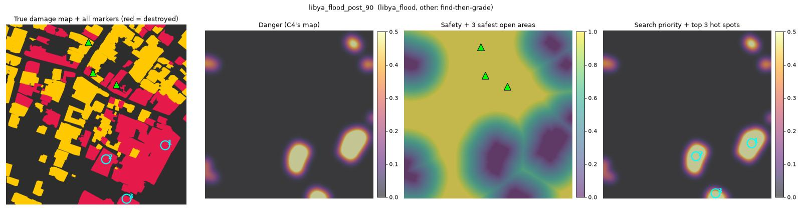
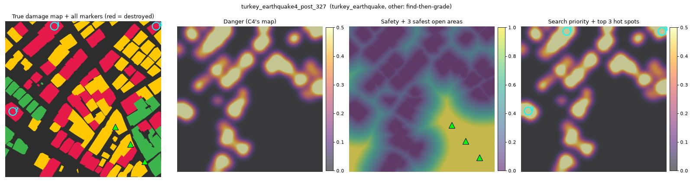
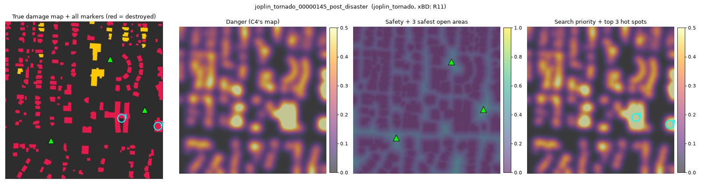
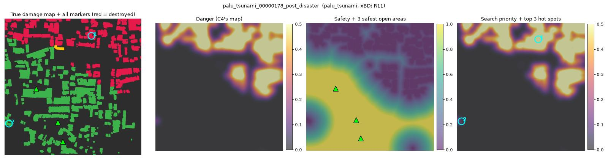

# E7 step 3: C4's damage maps, building table and hot spots on the test photos

The question, what it makes, the checks and the expectation, fixed before the run, are in the notebook's first cell ([`e7-step3-c4-table-and-hot-spots.ipynb`](../../e7-step3-c4-table-and-hot-spots.ipynb)).

**C4** is the damage-map method Abrar chose on 19 Nov: R11, our pixel model, on the coarser xBD photos, and find-then-grade (SAM 3 outlines each building, our grader labels it) on the sharper photos such as Turkey's.

Run on a PC, no GPU, in 54.7 min: 2065 test photos, 2007 of them clean pairs (the ones with trusted true masks, E6).

## Checks

```
                                                                       check                             result
                 1. The file-name rule gives E6's source for every test pair                             passed
2. Seed 42's map, rebuilt from the outlines and scores, equals the saved one       passed: 99.999566% of pixels
                    3. The scores reproduce the published ones within 0.0005                             passed
                         4. H2's row code rebuilds E7 step 2's table exactly              passed on 2065 photos
                                      5. T1 v3's and the table's self-checks                             passed
                        6. Ridita's bridge reads the table and the hot spots passed (an xBD and an other photo)
```

## Scores on the clean pairs

Reproduced from the saved files:

```
                                                   what  rebuilt  published                              from  difference  pass
                                     R11: destroyed_iou   0.3984     0.3984         E7 step 2, map_scores.csv      0.0000  True
                                              R11: miou   0.5721     0.5721         E7 step 2, map_scores.csv      0.0000  True
                                      R11: building_iou   0.6944     0.6944         E7 step 2, map_scores.csv      0.0000  True
                               chain_s42: destroyed_iou   0.4055     0.4055         E7 step 2, map_scores.csv      0.0000  True
                                        chain_s42: miou   0.5180     0.5179         E7 step 2, map_scores.csv      0.0001  True
                                chain_s42: building_iou   0.5395     0.5395         E7 step 2, map_scores.csv      0.0000  True
                               chain_s43: destroyed_iou   0.3982     0.3983         E7 step 2, map_scores.csv     -0.0001  True
                                        chain_s43: miou   0.5121     0.5121         E7 step 2, map_scores.csv      0.0000  True
                                chain_s43: building_iou   0.5406     0.5405         E7 step 2, map_scores.csv      0.0001  True
                               chain_s44: destroyed_iou   0.3657     0.3657         E7 step 2, map_scores.csv      0.0000  True
                                        chain_s44: miou   0.5086     0.5087         E7 step 2, map_scores.csv     -0.0001  True
                                chain_s44: building_iou   0.5447     0.5447         E7 step 2, map_scores.csv      0.0000  True
           C4, mean of three seeds: destroyed_iou (all)   0.4295     0.4296 E7 step 2c, test_confirmation.csv     -0.0001  True
                          C4, mean of three seeds: miou   0.5555     0.5555 E7 step 2c, test_confirmation.csv      0.0000  True
                  C4, mean of three seeds: building_iou   0.6221     0.6221 E7 step 2c, test_confirmation.csv      0.0000  True
        C4, mean of three seeds: destroyed_iou (Turkey)   0.3231     0.3231 E7 step 2c, test_confirmation.csv      0.0000  True
C4, mean of three seeds: destroyed_iou (without Turkey)   0.4610     0.4610 E7 step 2c, test_confirmation.csv      0.0000  True
```

C4 per grader seed (the output map and the table use seed 42):

```
method   miou  destroyed_iou  building_iou  destroyed_precision  destroyed_recall
C4_s42 0.5566         0.4358        0.6216               0.5995            0.6148
C4_s43 0.5582         0.4393        0.6217               0.6132            0.6077
C4_s44 0.5517         0.4135        0.6230               0.5449            0.6317
```

## The building table (`buildings_c4.sqlite`)

H2's columns, read unchanged by Ridita's bridge, plus `kind`: `outline` = one building SAM 3 outlined (the sharper photos); `patch` = one connected patch of R11's pixels (xBD photos), which can hold several touching buildings. The `images` table gives each photo's source and method.

```
source    kind  photos  intact  damaged  destroyed  rows  e7_step2_rows
 other outline     739   53953     1310       2586 57849          46458
   xBD   patch    1326   47652    12839       7099 67590          58138
```

On the sharper photos the table has 57,849 buildings, against E7 step 2's 46,458 joined blobs for the same grades (+24.5%): touching buildings no longer merge.

## Hot spots and safe areas (`hotspots.json`, T1 v3's method and settings)

On the clean pairs, against the true masks:

```
   images_from source  images  hot_spots  on_gt_destroyed  ceiling_from_gt_mask  on_gt_damaged_or_destroyed  point_on_gt_destroyed  point_on_gt_damage  points_within_5px_of_edge  safe_on_gt_building
   clean pairs    all    2007       2775            0.316                 0.486                       0.603                  0.264               0.569                      0.012                0.071
   clean pairs  other     739        770            0.347                 0.507                       0.544                  0.288               0.497                      0.006                0.159
   clean pairs    xBD    1268       2005            0.304                 0.474                       0.626                  0.255               0.596                      0.014                0.039
with destroyed    all     687       1448            0.606                 0.721                       0.865                  0.506               0.827                      0.006                0.054
with destroyed  other     236        451            0.592                 0.765                       0.743                  0.492               0.690                      0.000                0.153
with destroyed    xBD     451        997            0.612                 0.698                       0.920                  0.513               0.889                      0.008                0.009
```

- `point_on_gt_damage`: share of hot spots whose marked point is within 20 px of a truly damaged or destroyed building. T1 v3 on validation, from R9's maps: 0.736.
- `on_gt_destroyed`: share of hot-spot zones touching truly destroyed pixels; read it against `ceiling_from_gt_mask`, the same share when the method runs on the true mask.
- `safe_on_gt_building`: share of safe areas that sit on a true building.

Photos outside the clean pairs get hot spots too; their ground-truth fields are empty.

Examples (overlays of the photos with the most true destroyed pixels):









## Counting, beside (deciding nothing)

From E7 step 2's saved counts (blobs of at least 20 px, the nearest answer option): R11's on xBD photos, seed 42's on the others.

```
   method  questions  all_%  e5_clean_%  mean_abs_error  median_abs_error  within_20%_%
       C4       3580  35.34       34.89           12.61               4.0          34.3
      R11       3580  33.02       32.53           13.34               4.0          32.3
chain_s42       3580  32.88       32.70           13.58               4.0          30.7
```

Exact McNemar on E5's clean questions: {'C4 vs R11': {'only_first_right': 203, 'only_second_right': 120, 'p': 0.0}, 'C4 vs chain_s42': {'only_first_right': 376, 'only_second_right': 299, 'p': 0.0034}}.

## Against the expectation, fixed before the run

- all six checks pass: **yes**
- outline rows 5-20% above E7 step 2's joined blobs on the sharper photos: **no**
- hot spots' points on true damage 0.70-0.85 on the clean pairs: **no**
- counting within 1.5 points of R11 and of seed 42 on E5's clean questions: **no**

## What Ridita's report writer reads (check 6)

```
=== MODEL-ESTIMATED DAMAGE FACTS FOR IMAGE: hawaii_wildfire_post_638.png ===
(Counts and hot spots come from a damage model's map: estimates, not ground truth. Positions in image pixels.)
- Building Counts:
  * Intact Buildings: 5
  * Damaged Buildings: 0
  * Destroyed Buildings: 217
  * Total Buildings in the table: 222

- Survivability Heatmap:
  * Hot Spots (where the estimated damage is densest):
    - Hot spot #1: marked point at (x=266, y=403), sector: west, zone area: 564947 px
    - Hot spot #2: marked point at (x=102, y=748), sector: south-west, zone area: 90567 px
    - Hot spot #3: marked point at (x=335, y=32), sector: north-west, zone area: 2600 px
  * Safe Open Areas (open ground farthest from the estimated damage):
    - Safe area #1: point at (x=923, y=707), sector: south-east, distance to the nearest damage: 255 px
    - Safe area #2: point at (x=923, y=857), sector: south-east, distance to the nearest damage: 242 px
    - Safe area #3: point at (x=923, y=557), sector: east, distance to the nearest damage: 214 px
==============================================================
```

## Files

- `buildings_c4.sqlite`: the table (`buildings`, `images`); `table_summary.csv`
- `hotspots.json`, `hotspots_per_image.csv`, `hotspots_summary.csv`
- `scores.csv` (every method and scope), `scores_reproduced.csv` (check 3), `counting.csv`, `config.json`
- `overlays/`: 20 photos to check by eye; `maps/` (256 px danger, safety, priority) and `c4_maps.zip` are git-ignored

## Next

- T2 step 5 (Ridita): point the report bridge at `E7-results/step3/buildings_c4.sqlite` and `E7-results/step3/hotspots.json`. Where `kind` is `patch`, a row may hold several touching buildings, so a report must not call it one building.
