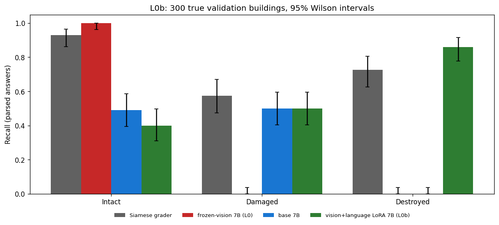

# L0b results: training the 7B's vision encoder on building crops

Start model `AbrarAlam/disasterm3-qwen2.5vl7b-l0s2-mergedFP` (4-bit NF4), LoRA (`r=64, alpha=16`) on 196 language modules (161,480,704 params) + 160 vision modules (44,605,440 params) = 206,086,144 trainable parameters. Trained on 1800 balanced training building crops in 57 steps (47.88 min on 2x T4, peak GPU0 9.64 GB).

## Recall on Part B's 300 true validation buildings (100 per class, 605 clean pairs)

| run             | class             |   buildings |   parsed |   right |   recall |   ci_low |   ci_high | class_matches_own_grade   |
|:----------------|:------------------|------------:|---------:|--------:|---------:|---------:|----------:|:--------------------------|
| grader          | Intact            |         100 |       99 |      92 |   0.9293 |   0.8612 |    0.9653 |                           |
| grader          | Damaged           |         100 |       94 |      54 |   0.5745 |   0.4735 |    0.6696 |                           |
| grader          | Destroyed         |         100 |       91 |      66 |   0.7253 |   0.6259 |    0.8064 |                           |
| grader          | mean of the three |         300 |      284 |     212 |   0.743  |   0.6965 |    0.7908 |                           |
| finetuned       | Intact            |         100 |      100 |     100 |   1      |   0.963  |    1      | 61/100                    |
| finetuned       | Damaged           |         100 |      100 |       0 |   0      |   0      |    0.037  | 49/100                    |
| finetuned       | Destroyed         |         100 |      100 |       0 |   0      |   0      |    0.037  | 36/100                    |
| finetuned       | mean of the three |         300 |      300 |     100 |   0.3333 |   0.3333 |    0.3333 |                           |
| base            | Intact            |         100 |      100 |      49 |   0.49   |   0.3942 |    0.5865 | 5/100                     |
| base            | Damaged           |         100 |      100 |      50 |   0.5    |   0.4038 |    0.5962 | 2/100                     |
| base            | Destroyed         |         100 |      100 |       0 |   0      |   0      |    0.037  | 2/100                     |
| base            | mean of the three |         300 |      300 |      99 |   0.33   |   0.2833 |    0.3767 |                           |
| l0b_vision_lora | Intact            |         100 |      100 |      40 |   0.4    |   0.3094 |    0.498  | 55/100                    |
| l0b_vision_lora | Damaged           |         100 |      100 |      50 |   0.5    |   0.4038 |    0.5962 | 49/100                    |
| l0b_vision_lora | Destroyed         |         100 |      100 |      86 |   0.86   |   0.7786 |    0.9147 | 88/100                    |
| l0b_vision_lora | mean of the three |         300 |      300 |     176 |   0.5867 |   0.5367 |    0.64   |                           |

## Paired exact McNemar tests

| comparison                   | class     |   buildings |   l0b_right |   other_right |   both_right |   only_l0b_right |   only_other_right |   both_wrong |   mcnemar_p | verdict                  |
|:-----------------------------|:----------|------------:|------------:|--------------:|-------------:|-----------------:|-------------------:|-------------:|------------:|:-------------------------|
| l0b_vision_lora vs grader    | Intact    |         100 |          40 |            92 |           37 |                3 |                 55 |            5 |    0        | l0b lower than grader    |
| l0b_vision_lora vs grader    | Damaged   |         100 |          50 |            54 |           31 |               19 |                 23 |           27 |    0.643969 | not distinguishable      |
| l0b_vision_lora vs grader    | Destroyed |         100 |          86 |            66 |           61 |               25 |                  5 |            9 |    0.000325 | l0b higher               |
| l0b_vision_lora vs grader    | all three |         300 |         176 |           212 |          129 |               47 |                 83 |           41 |    0.002024 | l0b lower than grader    |
| l0b_vision_lora vs finetuned | Intact    |         100 |          40 |           100 |           40 |                0 |                 60 |            0 |    0        | l0b lower than finetuned |
| l0b_vision_lora vs finetuned | Damaged   |         100 |          50 |             0 |            0 |               50 |                  0 |           50 |    0        | l0b higher               |
| l0b_vision_lora vs finetuned | Destroyed |         100 |          86 |             0 |            0 |               86 |                  0 |           14 |    0        | l0b higher               |
| l0b_vision_lora vs finetuned | all three |         300 |         176 |           100 |           40 |              136 |                 60 |           64 |    0        | l0b higher               |
| l0b_vision_lora vs base      | Intact    |         100 |          40 |            49 |           33 |                7 |                 16 |           44 |    0.09314  | not distinguishable      |
| l0b_vision_lora vs base      | Damaged   |         100 |          50 |            50 |           29 |               21 |                 21 |           29 |    1        | not distinguishable      |
| l0b_vision_lora vs base      | Destroyed |         100 |          86 |             0 |            0 |               86 |                  0 |           14 |    0        | l0b higher               |
| l0b_vision_lora vs base      | all three |         300 |         176 |            99 |           62 |              114 |                 37 |           87 |    0        | l0b higher               |

## Verdict (by the rule fixed in Roadmap L0b)

Beats the frozen-vision 7B (176 vs 100 of 300, only_l0b=136 vs only_ft=60, McNemar p = 0.0), but stays clearly below the Siamese grader (176 vs 212, only_l0b=47 vs only_grader=83, p = 0.002024). By L0b's rule: record that training the vision encoder helps the 7B see damage, and stop — the 45 MB grader keeps the grading, and a 34-GPU-hour full run is not needed.

## Files

- `config.json`, `train_summary.json`, `l0b_answers.csv`, `l0b_confusion.csv`, `l0b_recall.csv`, `l0b_paired.csv`, `l0b_recall_chart.png`
