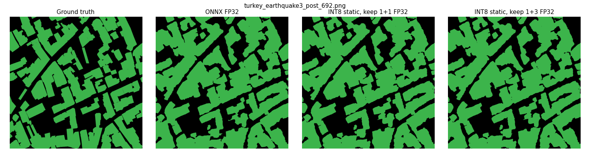

# L1c: R11 to 8-bit (INT8)

Machine: Intel(R) Xeon(R) CPU @ 2.20GHz, 4 threads, 33.7 GB RAM (Linux-6.18.55+-x86_64-with-glibc2.39). onnxruntime 1.32.0, torch 2.11.0+cpu. Checkpoint: AbrarAlam/disasterm3-d4-R11@31974dac.

L1b's recipe for R11, the U-Net that reads the after-photo (channels 0-2) and the before-photo (3-5): QDQ, per-channel weights, ranges from 100 training pairs, a few convolutions kept in FP32. Accuracy without TTA on 645 validation pairs (605 clean); speed as the median of 3 timed runs per image on 50 pairs, all versions in one session.

Checks: PyTorch and ONNX FP32 give the same class on at least 1.000000 of pixels (3 pairs); ONNX FP32 reproduces E5 step 2's R11 without TTA (0.5811 / 0.2911, within 0.001).

| variant                    |   file_mb |     bytes |   ms_per_image |   ms_p95 |   speedup_vs_onnx_fp32 |   miou |   destroyed_iou |   destroyed_drop |   miou_clean |   destroyed_iou_clean |   destroyed_drop_clean | int8_usable   |
|:---------------------------|----------:|----------:|---------------:|---------:|-----------------------:|-------:|----------------:|-----------------:|-------------:|----------------------:|-----------------------:|:--------------|
| ONNX FP32                  |     130   | 130048299 |           2364 |     2382 |                   1    | 0.5811 |          0.2911 |           0      |       0.5742 |                0.2641 |                 0      |               |
| INT8 static, keep 1+1 FP32 |      33.1 |  33145715 |           1835 |     1857 |                   1.29 | 0.5801 |          0.2897 |           0.0014 |       0.5734 |                0.263  |                 0.0011 | yes           |
| INT8 static, keep 1+3 FP32 |      33.2 |  33163619 |           1751 |     1770 |                   1.35 | 0.5801 |          0.2897 |           0.0014 |       0.5733 |                0.263  |                 0.0011 | yes           |

**Verdict:** R11's edge model: INT8 static, keep 1+3 FP32 (r11_int8_static_keep1_3.onnx, 33,163,619 bytes), 1.35x the speed of ONNX FP32, destroyed IoU drop 0.0014 (limit 0.01; 0.0011 on the clean pairs).

Convolutions kept in FP32:

- INT8 static, keep 1+1 FP32: /encoder/conv1/Conv, /segmentation_head/segmentation_head.0/Conv
- INT8 static, keep 1+3 FP32: /encoder/conv1/Conv, /decoder/blocks.4/conv1/conv1.0/Conv, /decoder/blocks.4/conv2/conv2.0/Conv, /segmentation_head/segmentation_head.0/Conv

For the website: point `FIELD_MODEL` in `T3_Website/src/core/modelConfig.ts` at the chosen file, with its exact `bytes` from the table, and set `images: ['after', 'before']` (R11's channel order).

Files: `int8_r11.csv`, `r11_fp32.onnx`, the two static INT8 `.onnx` files, `config.json`.