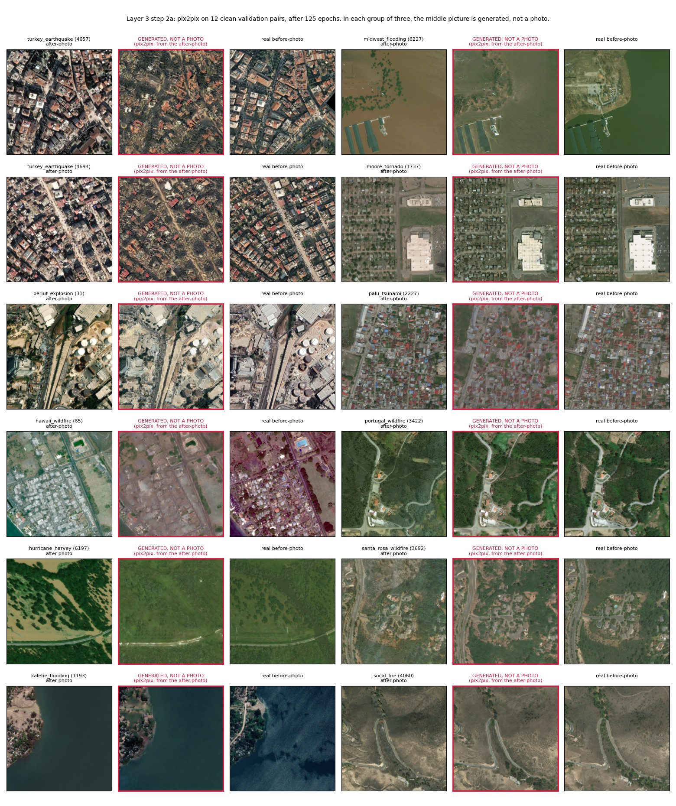

# Layer 3 step 2a: the pix2pix generator and its 645 generated before-photos

**Result: all six checks passed.** pix2pix trained for 125 epochs on the 5,798 training pairs only, in two Kaggle sessions. It then made a before-photo for each of the 645 validation after-photos. Every one of them is generated, not a photo.
- On the 605 clean pairs, the generated pictures are closer to the real before-photo than the after-photo itself (`copy`) by PSNR: 19.23 dB against 18.24. By SSIM (0.4588 against 0.4588) and LPIPS (0.4586 against 0.4620, lower is closer) they are about as close as `copy` ([`similarity.csv`](similarity.csv)).
- On Turkey's 64 clean pairs, they are closer than `copy` on all three. But in step 1, R11 found no destroyed buildings there even with the real before-photo.
- These distances decide nothing. Step 2b puts the pictures in R11's before-photo slot and applies the rule, against the bar of 0.5604.

*[`samples.jpg`](samples.jpg): 12 clean validation pairs, 2 of them from Turkey. In each group of three, the middle picture, framed in red, is **generated, not a photo**.*

## What and why

Step 2a trains pix2pix (Isola et al., CVPR 2017) to turn an after-photo into a likely before-photo. It learns from step 0's 5,798 training pairs and nothing else. It then runs on each of the 645 validation after-photos, at full size. Step 2b gives these pictures to R11 in place of the real before-photo and judges them by the rule. If R11 reached the bar with them, the system could use R11 where no before-photo exists. Each picture is an invention made from the after-photo: never evidence, and labelled "generated, not a photo" wherever it appears.

## How

- **Notebook:** [`layer3-step2a-pix2pix-train.ipynb`](../../layer3-step2a-pix2pix-train.ipynb), saved with session 2's outputs.
  - Its code is the tested file's, except two lines: `SMOKE_TEST = False` and `EPOCHS = 125`.
  - Before session 1 was started, the Kaggle copy was downloaded and compared cell by cell with the tested file: those two lines were the only difference.
  - Both sessions ran the same code.
- **Where:** Kaggle, Ridita's own account, notebook `layer3-step2a-pix2pix-train`. Accelerator "GPU T4 x2", of which the notebook uses one T4. Internet on, to install lpips 0.1.4 and download its AlexNet weights.
- **Inputs,** from the run notebooks' metadata:
  - the dataset `abrarmohammedtanzim/disasterm3-mirror` (Kaggle version 17834943);
  - the output of step 0's full run (Kaggle notebook `layer3-step0-pairs-and-checks`, version 371043607);
  - in session 2 only, session 1's output (this notebook's version 2, Kaggle id 374501709), for its `checkpoints/last.pt`.
- **The model,** written as in the authors' PyTorch code (`junyanz/pytorch-CycleGAN-and-pix2pix`, BSD licence), with its pix2pix defaults ([`summary.json`](summary.json): `config`, `parameters`):
  - a U-Net generator, `unet_256` (8 halvings, batch norm, dropout 0.5), with 54,413,955 parameters;
  - a 70 × 70 PatchGAN discriminator (3 layers), with 2,768,705 parameters. It gives 62 × 62 patch scores on a 512 px crop;
  - the "vanilla" GAN loss, plus the L1 loss with weight 100.

  Both parameter counts equal the reference code's, 54.414 M and 2.769 M. The notebook checks this before training.
- **Settings:** Adam, lr 2e-4, beta1 0.5, beta2 0.999; batch size 1; 125 epochs; seed 42 ([`summary.json`](summary.json): `config`).
  - **Learning rate:** 2e-4 up to epoch 63, then falling linearly to 3.2e-6 at epoch 125 ([`train_log.csv`](train_log.csv): `lr`).
  - **Image size:** training uses random 512 × 512 crops of the 1024 × 1024 photos. The same crop, rotation (0, 90, 180 or 270°) and flip go to both photos of a pair. Nothing is resized. Generation runs on the full 1024 × 1024 after-photo.
  - **Ours, not the reference's:** fp16 mixed precision in training, for speed on the T4.
  - **Generation:** in fp32, with the generator as in training (dropout on, batch norm with the picture's own statistics), as the paper and the reference's test script do. Each picture's dropout is seeded with 42 + its `pair_index`.
- **Seed 42:**
  - Python, NumPy and PyTorch are seeded with 42 before the networks are made.
  - Epoch e's order of pairs comes from NumPy's `default_rng([42, e])`, and pair i's crop, rotation and flip from `default_rng([42, e, i])`.
  - cuDNN's autotuner is on, so a second run on a GPU would give close, not bit-identical, weights.
- **Smoke test** (`SMOKE_TEST = True`): version 1, on 24 Nov, 14:01 to 14:09 UTC (Kaggle's record). From [`smoke-test/summary.json`](smoke-test/summary.json):
  - 3 epochs of 200 training pairs. After epoch 2, the checkpoint was saved, loaded into new networks and compared: every weight and optimizer value came back the same. Epoch 3 trained from the loaded copy;
  - all six checks passed, in 7.9 min;
  - `copy` on the 12 sample pairs gave the PC's numbers exactly: PSNR 16.788675, SSIM 0.377303, LPIPS 0.469525;
  - it measured 0.099 s per training pair, so 9.6 min per epoch, so EPOCHS = 125 by the first cell's rule (`smoke_proposal`).
- **Full run** (`SMOKE_TEST = False`, `EPOCHS = 125`). On 26 Nov, Abrar asked for the full run to go ahead without waiting for his go, and for the report afterwards. Session 1 started that evening.
  - **Session 1:** version 2, from 26 Nov 17:47 to 27 Nov 04:30 UTC (Kaggle's record). It trained epochs 1 to 106, then stopped by itself, because the next epoch would have ended after 10.75 hours. It took 642.4 min from Cell 2 on, and checks 1 and 2 passed ([`session-1/summary.json`](session-1/summary.json)).
  - **Session 2:** version 3, on 27 Nov, 05:38 to 07:56 UTC (the saved notebook's record). It continued from session 1's checkpoint ([`summary.json`](summary.json): `resumed_from`) and trained epochs 107 to 125. Then it generated the 645 pictures, in 17.2 min (`generation`). It took 137.3 min from Cell 2 on (`minutes_this_session`).
  - The 125 epochs took 749.4 min of training, or 12.5 hours (`training_minutes`).
  - In all, the three runs took 787.6 min from Cell 2 on (7.9 + 642.4 + 137.3), about 13.1 GPU hours, plus a few minutes per run for Kaggle's start-up and Cell 1's install.
- **Versions,** from [`summary.json`](summary.json): Python 3.13.16, PyTorch 2.11.0+cu130, torchvision 0.26.0+cu130, NumPy 2.1.3, OpenCV 4.14.0, pandas 2.3.3, scikit-image 0.25.2, lpips 0.1.4, matplotlib 3.10.0.
- **Before Kaggle,** the notebook was tested on the PC, on the CPU, with 256 px crops and 3 pairs per epoch:
  - the smoke test passed all six checks;
  - a run split into two sessions continued correctly from its checkpoint.

  `copy`'s numbers in the first cell were computed on the PC from the same photos.

## Expected before the run

Copied from the notebook's first cell, fixed on 24 Nov:

> **The expectation, fixed on 24 Nov before any run**
> - **Smoke test:** all six checks pass.
>   - Time per epoch: we guess 10 to 30 minutes, so EPOCHS between about 40 and 120.
>   - The 12 sample pictures will be poor after 600 training steps. That's expected and decides nothing.
> - **`copy`, computed on the PC** with Cell 7's code (the after-photo against the real before-photo):
>   - on the 605 clean pairs: PSNR 18.2438 dB, SSIM 0.4588, LPIPS 0.4620;
>   - on the 12 sample pairs: PSNR 16.7887 dB, SSIM 0.3773, LPIPS 0.4695.
>   - The 12 sample pairs (event, then `pair_index`): turkey_earthquake 4657; turkey_earthquake 4694; beriut_explosion 31; hawaii_wildfire 65; hurricane_harvey 6197; kalehe_flooding 1193; midwest_flooding 6227; moore_tornado 1737; palu_tsunami 2227; portugal_wildfire 3422; santa_rosa_wildfire 3692; socal_fire 4060.
> - **Full run:**
>   - L1 loss falls over the epochs.
>   - The pictures will be blurry. 52% of our pairs are shifted by more than 2 px between the two photos (Ridita's audit, `Task_Ledger.md` §9), and an L1 loss averages over the shift.
>   - Where buildings were destroyed, the generated picture will mostly show the rubble restyled, not the lost building: the after-photo has no information about what stood there.
>   - PSNR: the generated pictures closer to the real before-photo than `copy` is, because the L1 loss trains exactly that. SSIM and LPIPS: no prediction.
> - **Our guess for step 2b,** written now and deciding nothing:
>   - R11 with the generated pictures stays below the bar of 0.5604, and between `copy` (0.4046) and R9 (0.5402).
>   - The reason: a picture made from the after-photo can't show what the destroyed buildings looked like.
>   - On Turkey, no gain: even with the real before-photo, R11's destroyed IoU there is 0 (step 1).

## Result, against that expectation

| Expected | Found | From |
|---|---|---|
| Smoke test: all six checks pass | All six passed | [`smoke-test/summary.json`](smoke-test/summary.json): `checks` |
| 10 to 30 min per epoch, so EPOCHS about 40 to 120 | The smoke test measured 9.6 min, so EPOCHS = 125. The full run then took about 6.0 min per epoch (see "Problems") | [`smoke-test/summary.json`](smoke-test/summary.json): `smoke_proposal`; [`train_log.csv`](train_log.csv): `minutes` |
| The smoke test's 12 sample pictures are poor | They were: blurry, green-tinted, with a grid pattern | the smoke test's sample sheet, on Kaggle (version 1's output) |
| `copy` on the 605 clean pairs: PSNR 18.2438, SSIM 0.4588, LPIPS 0.4620 | 18.2438, 0.4588 and 0.4620 (unrounded 18.243759, 0.458838 and 0.461990) | [`summary.json`](summary.json): `similarity_clean` |
| `copy` on the 12 sample pairs: 16.7887, 0.3773, 0.4695 | The same | [`smoke-test/summary.json`](smoke-test/summary.json): `similarity_clean` |
| L1 loss falls over the epochs | From 0.2080 in epoch 1 to 0.1649 in epoch 125, with the lowest, 0.1647, in epoch 122 | [`train_log.csv`](train_log.csv): `loss_G_L1` |
| The pictures are blurry | Softer than the real photos, but roads, roofs and tree crowns mostly stay sharp (by eye, on the 12 samples) | [`samples.jpg`](samples.jpg) |
| Destroyed buildings: the rubble restyled, not the lost building | Yes, by eye: both Turkey samples keep their rubble, recoloured, and the burnt Hawaii block gets no houses back | [`samples.jpg`](samples.jpg) |
| PSNR: generated closer than `copy` | Yes: 19.2349 dB against 18.2438 on the 605 clean pairs; higher in 423 of them | [`similarity.csv`](similarity.csv); [`similarity_per_pair.csv`](similarity_per_pair.csv) |
| SSIM and LPIPS: no prediction | SSIM 0.4588 against 0.4588; LPIPS 0.4586 against 0.4620. Closer than `copy` by SSIM in 265 of the 605 pairs, by LPIPS in 273 | The same two files |
| Step 2b: below 0.5604, between `copy` and R9; no gain on Turkey | Not tested yet: that is step 2b | |

**How close each picture is to the real before-photo,** on the 605 clean pairs, from [`similarity.csv`](similarity.csv) (pairs `clean`). Higher PSNR and SSIM, and lower LPIPS, mean closer.

| Group | Pairs | PSNR (dB), generated / `copy` | SSIM, generated / `copy` | LPIPS, generated / `copy` |
|---|---|---|---|---|
| All | 605 | 19.23 / 18.24 | 0.4588 / 0.4588 | 0.4586 / 0.4620 |
| Turkey | 64 | 12.20 / 10.16 | 0.1764 / 0.1625 | 0.5551 / 0.5862 |
| Not Turkey | 541 | 20.07 / 19.20 | 0.4922 / 0.4939 | 0.4471 / 0.4473 |

**Turkey, reported separately.**
- On its 64 clean pairs, the generated pictures are closer than `copy` on all three distances. PSNR is higher in 63 of the 64 pairs ([`similarity_per_pair.csv`](similarity_per_pair.csv)).
- Closer isn't better for the rule there. In step 1, R11 scored destroyed IoU 0.000 on Turkey even with the real before-photo ([step 1's README](../step1/README.md)).
- So step 2b should show no gain on Turkey, as expected.

**By event,** for the 12 events with at least 20 clean pairs ([`similarity_per_pair.csv`](similarity_per_pair.csv)):
- PSNR is higher than `copy`'s in 11 of the 12. The exception is socal_fire, at −0.33 dB.
- LPIPS splits them in two:
  - the generated pictures are closer in the 6 events where `copy` is farthest from the real before-photo (its LPIPS 0.463 to 0.606): midwest_flooding −0.081, nepal_flooding −0.074, hurricane_matthew −0.043, santa_rosa_wildfire −0.042, turkey_earthquake −0.031 and hurricane_harvey −0.028;
  - they are farther in the 6 where `copy` is already closest (0.331 to 0.447): pinery_bushfire +0.079, socal_fire +0.039, hurricane_michael +0.024, hurricane_florence +0.016, tuscaloosa_tornado +0.011 and portugal_wildfire +0.008.
- This fits a generator that mostly undoes broad changes of colour, such as flood water, and adds texture of its own where little changed. On the sheet, Harvey's brown flood water becomes green grass.

**Training losses** ([`train_log.csv`](train_log.csv)):
- The GAN stayed balanced over the 125 epochs. The discriminator's losses stayed between 0.31 and 0.46 (real 0.3499 to 0.4570, fake 0.3130 to 0.3875), and the generator's GAN loss between 1.78 and 2.29.
- No step had a loss that was not finite.

## Checks

| Check | Result |
|---|---|
| 1. Step 0's `pairs.csv`: its full run; 6,443 pairs, 5,798 / 645, 605 clean; every photo 1024 × 1024 | passed |
| 2. Training sees only training photos | passed: 125 epochs, each with all 5,798 training pairs once. No validation photo is among them by name or by path, and, by step 0's pixel hashes, no photo of a clean validation pair. 40 validation pairs share a photo with training, none of them clean |
| 3. Training ran all its epochs, and every loss stayed finite | passed: 125 of 125 epochs, 0 steps with a loss that is not finite. In the smoke test, the reloaded checkpoint also matched |
| 4. All 645 pictures in the zip: 1024 × 1024 RGB PNG, named like the after-photos, reading back exactly | passed: 645 PNGs, with the expected names, and every file's checksum in the zip right |
| 5. The sample sheet: 12 clean validation pairs from 11 events, 2 of them Turkey | passed |
| 6. PSNR, SSIM and LPIPS finite; `copy` matches the PC on the 605 clean pairs | passed: 18.243759 / 0.458838 / 0.461990 here, 18.243759 / 0.458838 / 0.461989 on the PC (tolerance 0.001 / 0.0001 / 0.001) |

From [`summary.json`](summary.json) (`checks`) and the printout of the notebook's last cell.
- Session 1 passed checks 1 and 2 ([`session-1/summary.json`](session-1/summary.json)).
- Its 106 rows of the training log are carried unchanged into session 2's [`train_log.csv`](train_log.csv).

## Problems and anything surprising

**The smoke test over-estimated the time per epoch.** It measured 0.099 s per training pair, so 9.6 min per epoch ([`smoke-test/summary.json`](smoke-test/summary.json)). The full run took 0.062 s, about 6.0 min per epoch ([`train_log.csv`](train_log.csv): `minutes`).
- **Most likely the first reading of each photo.**
  - In session 1, epoch 1 took 8.652 min (0.090 s per pair), and epochs 2 to 106 took 5.955 to 5.975 min each.
  - Session 2's first epoch took 6.356 min, so Kaggle's storage seems to have kept the photos warm between the sessions.
  - Each smoke-test epoch read 200 pairs it hadn't read before. In such short epochs, each epoch's start-up also counts for more.
- **So session 1 got through 106 of the 125 epochs,** and session 2 needed only 2.3 hours.
- **With the true speed, the first cell's rule** (20 hours of training, at most 200 epochs) **would have given about 200 epochs instead of 125:** 20 × 60 / 5.99 min per epoch ([`summary.json`](summary.json): `minutes_per_epoch_mean`).
  - The number can't change in the middle of a run: it is part of the checkpoint's settings, and the learning rate's fall is spread over it.
  - So the run kept 125 epochs, 12.5 hours of training.
  - Whether a 200-epoch run (about 20 GPU hours) is worth it can be judged after step 2b.

**Shifted pairs, the brief's known difficulty.** 52% of our pairs are shifted by more than 2 px between the two photos.
- Ridita's audit measured 52% of the 2,966 measurable pairs above 2 px and 10% above 5 px, the worst by 56 px ([`Task_Ledger.md`](../../../Task_Ledger.md), section 9, "The DisasterM3–BRIGHT audit").
- On the 605 clean validation pairs, R16c step 6 measured 47% above 2 px and 17% above 5 px ([its README](../../../Champion_Task/R16c-results/step6/README.md)).
- An L1 loss on shifted pairs pulls the output toward the average of the shifted positions, which blurs it.
- We trained on the pairs as they are, as R11 was trained. Aligning the pairs first is a possible follow-up, not part of this step.

**Closer by PSNR, but not by SSIM or LPIPS.**
- The L1 loss trains PSNR directly, so the gain of 1.0 dB was expected.
- SSIM and LPIPS barely move overall (−0.0001 and −0.0034). Only 139 of the 605 clean pairs are closer than `copy` on all three ([`similarity_per_pair.csv`](similarity_per_pair.csv)).
- By eye, the generator mostly recolours the after-photo, and seldom restores what was lost.

**The pictures are stored in one zip.**
- Kaggle may limit a notebook's saved output to about 500 files (not confirmed).
- So the 645 PNGs are packed, uncompressed, into `generated_before_photos.zip`, with a README.txt that says they are generated.
- Step 1's notebook reads a folder, so step 2b must unpack the zip first.

## Next

**Step 2b,** as the brief says: step 1's notebook again, with `BEFORE_SOURCE = ["real", "copy", "folder:<the generated pictures>"]` and version 3's output attached.
- `real` and `copy` stay, so the run checks the reproduction again and gives test 3's baseline.
- A few added lines check the zip's SHA-256 against this step's [`summary.json`](summary.json) and unpack it into that folder.
- The smoke test comes first. If its checks pass, the full run follows without waiting, as Abrar asked on 26 Nov.
- The bar stays 0.5604. The first cell's guess: R11 with the generated pictures stays below the bar, between `copy` (0.4046) and R9 (0.5402), with no gain on Turkey.

## Files

- [`samples.jpg`](samples.jpg): the sheet of 12 clean validation pairs, each as after-photo, generated picture and real before-photo. The middle picture of each three is generated, not a photo.
- [`similarity_per_pair.csv`](similarity_per_pair.csv): 645 rows, one per validation pair. Each holds:
  - the photo names, the event, the source and the clean flag;
  - whether the generated picture has the right shape and reads back exactly;
  - PSNR, SSIM and LPIPS against the real before-photo, for the generated picture and for `copy`.
- [`similarity.csv`](similarity.csv): their means, on all 645 pairs and on the 605 clean ones. Each is given overall, for Turkey, for the rest, and per event.
- [`train_log.csv`](train_log.csv): 125 rows, one per epoch: learning rate, pairs, the four losses, steps with a loss that is not finite, minutes and session.
- [`summary.json`](summary.json):
  - the settings, versions, parameter counts, sessions and times;
  - the generation's record, with the SHA-256 of the zip and of the final generator;
  - the similarity means and the six checks.
- [`session-1/`](session-1/): session 1's `summary.json` and `train_log.csv`. They cover epochs 1 to 106; then the session stopped for time.
- [`smoke-test/`](smoke-test/): the smoke test's `summary.json`, `train_log.csv`, `similarity.csv` and `similarity_per_pair.csv`. Its sample sheet stays on Kaggle (version 1's output), so that git holds at most 12 sample pictures for this step, as the brief asks.
- **On Kaggle only,** in version 3's output of `layer3-step2a-pix2pix-train`. They are too large for git (brief, section 6):
  - `generated_before_photos.zip`: the 645 PNGs, named like the after-photos, and a README.txt. It is 1,092.2 MiB, SHA-256 `8a75762301a4fc0ee85fb62db1c6b591a6c5ebcbc56d64590b3bd2173a6c6137`;
  - `checkpoints/generator_final.pt`: the generator alone, for step 5. SHA-256 `05da9ab2e655b24a7d02a5cad009c7d08755f771876fb5a4c213824e5d21069c`;
  - `checkpoints/last.pt`: everything needed to continue training.
