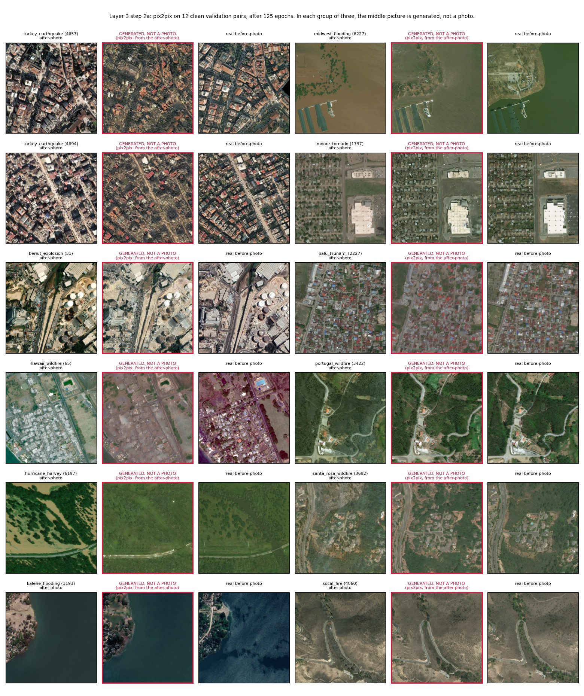

# Layer 3 step 2b: R11 with the generated before-photos, judged by the rule

**Result: the pix2pix generator fails the rule. All five checks passed.**
- With step 2a's generated before-photos, R11 scores mIoU 0.4216 on the 605 clean pairs. That is below the bar of 0.5604, and below R9's 0.5402 ([`rule_tests.csv`](rule_tests.csv)).
  - Test 1, reaching 0.5604: no.
  - Test 2, above R9: no. The difference is −0.1186, and the middle 95% of the resamples runs from −0.1328 to −0.1025.
  - Test 3, above `copy`: yes, only just. The difference is +0.0170, from +0.0001 to +0.0359.
- That is about a tenth of the way from `copy` (0.4046) to the real before-photo (0.5805).
- On Turkey, no gain: R11's destroyed IoU there stays 0.000, as with the real before-photo ([`scores.csv`](scores.csv)).
- This is what we expected before the run.

*Step 2a's [`samples.jpg`](../step2a/samples.jpg), for what R11 read here. In each group of three, the middle picture, framed in red, is **generated, not a photo**.*

## What and why

Step 2b judges step 2a's generator by the rule (brief, section 4). R11 reads each validation pair's generated before-photo in place of the real one, and its map is scored as in step 1. If R11 recovered at least half of what the real before-photo adds over R9, and more than noise, the system could use R11 where no before-photo exists. `real` and `copy` run again beside it: `real` must reproduce E5 step 2 for the bar to stand, and `copy` is test 3's baseline.

## How

- **Notebook:** [`layer3-step2b-pix2pix-scores.ipynb`](../../layer3-step2b-pix2pix-scores.ipynb), saved with the full run's outputs.
  - It is step 1's notebook. The evaluation code is word for word the same; its first cell lists what changed: `BEFORE_SOURCE`, a few lines that unpack step 2a's pictures, the output folder and the labels.
  - The code that ran is the tested file's, except `SMOKE_TEST = False`.
  - Before Kaggle, the added lines were tested on the PC with a small zip. They unpacked it, and they stopped on a wrong SHA-256, on a smoke-test output, and on a second copy of the output.
- **Where:** Kaggle, Ridita's own account, notebook `layer3-step2b-pix2pix-scores`. Accelerator "GPU T4 x2", of which the notebook uses one T4. Internet on, to install segmentation-models-pytorch 0.3.4, as in step 1.
- **Inputs,** from the run notebook's metadata:
  - the dataset `abrarmohammedtanzim/disasterm3-mirror` (Kaggle version 17834943);
  - the dataset `abrarmohammedtanzim/disasterm3-r11-r9-checkpoints` (Kaggle version 22331169);
  - the output of step 0's full run (`layer3-step0-pairs-and-checks`, version 371043607);
  - the output of step 2a's full run (`layer3-step2a-pix2pix-train`, version 3, Kaggle id 374689093).
- **The generated pictures,** from [`summary.json`](summary.json) (`step2a_pictures`):
  - 645 PNGs, unpacked into `/tmp/pix2pix` from step 2a's `generated_before_photos.zip`;
  - the zip's SHA-256, `8a75762301a4fc0ee85fb62db1c6b591a6c5ebcbc56d64590b3bd2173a6c6137`, is the one in [step 2a's `summary.json`](../step2a/summary.json).
- **Checkpoints:** the same R11 and R9 as in step 1, by SHA-256 ([`summary.json`](summary.json): `checkpoints`).
- **Smoke test** (`SMOKE_TEST = True`): version 1, on 27 Nov, on E5 step 2's first 8 validation pairs. All five checks passed, in 26.3 min. On those 8 pairs:
  - R11 real scored 0.6190 / 0.0906 and R9 0.5546 / 0.1227, the same as E5 step 2;
  - `copy` scored 0.3599 / 0.0172, the same as step 1's smoke test;
  - the generated pictures scored 0.3637 / 0.0022.

  These numbers come from the smoke run's printout. Its output files stay on Kaggle.
- **Full run** (`SMOKE_TEST = False`): version 2, on 27 Nov, 10:25 to 11:14 UTC (the saved notebook's record). It started as soon as the smoke test had passed, as Abrar asked on 26 Nov.
  - It took 49.0 min from Cell 2 on. R11's three runs took 20.9 min, and R9's 5.8 min ([`summary.json`](summary.json): `minutes`, `model_minutes`).
- **Versions,** from [`summary.json`](summary.json): Python 3.13.16, PyTorch 2.11.0+cu130, segmentation-models-pytorch 0.3.4, NumPy 2.1.3, OpenCV 4.14.0, pandas 2.3.3, scikit-learn 1.6.1.
- **Seed 42:** the split's `random_state=42`, and the 10,000 resamples of the rule's tests ([`summary.json`](summary.json): `resampling`).

## Expected before the run

Copied from the notebook's first cell, fixed on 27 Nov:

> **The expectation, fixed on 27 Nov before any run**
> - All five checks pass, so the bar stays 0.5604.
> - `copy` gives step 1's numbers again: mIoU 0.4046 and destroyed IoU 0.0431 on the 605 clean pairs (smoke test: 0.3599 and 0.0172 on its 8 pairs).
> - The guess written in step 2a's first cell on 24 Nov, unchanged:
>   - R11 with the generated pictures stays below the bar of 0.5604, and between `copy` (0.4046) and R9 (0.5402);
>   - the reason: a picture made from the after-photo can't show what the destroyed buildings looked like;
>   - on Turkey, no gain: even with the real before-photo, R11's destroyed IoU there is 0 (step 1).
> - If so, the generator fails tests 1 and 2, and so the rule, whatever test 3 says.
> - Destroyed IoU, building IoU and building precision: no prediction.
> - Known from step 2a, deciding nothing: on the 605 clean pairs, the generated pictures are closer to the real before-photo than `copy` by PSNR (19.23 against 18.24 dB), and about as close by SSIM and LPIPS.

## Result, against that expectation

| Expected | Found | From |
|---|---|---|
| All five checks pass, so the bar stays 0.5604 | All five passed. The bar stays 0.5604; our own numbers give 0.560378 | [`summary.json`](summary.json): `checks`, `bar`, `own_bar` |
| `copy` gives step 1's numbers: 0.4046 and 0.0431 (smoke test: 0.3599 and 0.0172) | 0.4046 and 0.0431 (smoke test: 0.3599 and 0.0172). R11 real, `copy` and R9 give step 1's counts exactly: not one pixel differs in any of their 1,290 rows each | [`scores.csv`](scores.csv); [`per_pair.csv`](per_pair.csv) against [step 1's](../step1/per_pair.csv) |
| The generator below the bar of 0.5604 | 0.4216 | [`rule_tests.csv`](rule_tests.csv) |
| Between `copy` (0.4046) and R9 (0.5402) | Yes, and much nearer `copy` | [`rule_tests.csv`](rule_tests.csv) |
| No gain on Turkey | None: destroyed IoU 0.000, and mIoU 0.2608, below `copy`'s 0.2729 | [`scores.csv`](scores.csv): group `Turkey` |
| It fails tests 1 and 2, and so the rule, whatever test 3 says | It fails tests 1 and 2. It passes test 3 by the smallest margin: the interval's lower end is +0.0001 | [`rule_tests.csv`](rule_tests.csv) |
| Destroyed IoU, building IoU and building precision: no prediction | 0.1029, 0.4343 and 0.6851 | [`scores.csv`](scores.csv) |

**The rule's three tests** on the 605 clean pairs, from [`rule_tests.csv`](rule_tests.csv). For `real` and `copy` they decide nothing.

| Run | mIoU | 1. Reaches 0.5604 | 2. Minus R9 (middle 95%) | 3. Minus `copy` (middle 95%) | Passes |
|---|---|---|---|---|---|
| R11 real | 0.5805 | yes | +0.0403 (0.0154 to 0.0632) | +0.1760 (0.1457 to 0.2087) | yes, as the reference |
| R11 copy | 0.4046 | no | −0.1356 (−0.1552 to −0.1146) | (itself) | no |
| **R11 generated** (`folder:/tmp/pix2pix`) | **0.4216** | **no** | **−0.1186 (−0.1328 to −0.1025)** | **+0.0170 (+0.0001 to +0.0359)** | **no** |

**Each run on the 605 clean pairs,** 8-view TTA, from [`scores.csv`](scores.csv) (mode `tta`, pairs `clean`, group `all`):

| Run | mIoU | Destroyed IoU | Building IoU | Building precision |
|---|---|---|---|---|
| R11 real | 0.5805 | 0.2692 | 0.7429 | 0.8347 |
| R11 copy | 0.4046 | 0.0431 | 0.5040 | 0.6781 |
| R11 generated | 0.4216 | 0.1029 | 0.4343 | 0.6851 |
| R9 | 0.5402 | 0.2874 | 0.5905 | 0.6686 |

Without TTA the order is the same: R11 generated 0.4189, `copy` 0.4016, R9 0.5338 and R11 real 0.5742 ([`scores.csv`](scores.csv): mode `std`).

**Turkey and the rest,** mIoU / destroyed IoU, 8-view TTA, clean pairs ([`scores.csv`](scores.csv)):

| Run | Turkey (64 pairs) | Not Turkey (541 pairs) |
|---|---|---|
| R11 real | 0.4073 / 0.0000 | 0.6120 / 0.3875 |
| R11 copy | 0.2729 / 0.0000 | 0.4383 / 0.0684 |
| R11 generated | 0.2608 / 0.0000 | 0.4628 / 0.1575 |
| R9 | 0.3860 / 0.2577 | 0.5660 / 0.3068 |

**By event,** for the 12 events with at least 20 clean pairs ([`scores.csv`](scores.csv), mode `tta`, pairs `clean`):
- R11 with the generated pictures beats `copy` in 9 of the 12. The biggest gains are santa_rosa_wildfire +0.0645, hurricane_matthew +0.0446 and socal_fire +0.0361.
- It falls below `copy` in midwest_flooding (−0.0166), turkey_earthquake (−0.0121) and tuscaloosa_tornado (−0.0049).
- It reaches R9 in none of them. The closest is midwest_flooding, at −0.0307.

**What the generated pictures change in R11's map,** over the 605 clean pairs with 8-view TTA ([`per_pair.csv`](per_pair.csv)):
- **Destroyed pixels:** R11 marks 456,209 pixels destroyed, against 1,652,299 that truly are. That is more than with `copy` (211,136), but far fewer than with the real before-photo (1,093,234). R9 marks 2,053,741.
- **Building pixels:** R11 marks 39.4 million pixels as some building, against 48.6 million with `copy` and 51.9 million with the real before-photo. So its building IoU falls to 0.4343, below `copy`'s 0.5040.

## Checks

| Check | Result |
|---|---|
| 1. Step 0's `pairs.csv`: its full run, the same split, 605 clean | passed: 6,443 pairs, 5,798 / 645, 605 clean, the same events |
| 2. The gray colour is the training before-photos' mean, (86, 91, 69) | passed: the mean (85.5376, 90.7482, 69.2667) of 5,798 photos |
| 3. R11 real reproduces E5 step 2 (within 0.001) | passed: 0.5805 / 0.2692 on the 605 clean pairs, 0.5875 / 0.2965 on all 645 |
| 4. R9 reproduces E5 step 2 (within 0.001) | passed: 0.5402 / 0.2874 on the 605, 0.5440 / 0.3001 on all 645 |
| 5. Every run scored every validation pair | passed: 5,160 rows, 4 runs × 2 modes × 645 pairs |

From [`summary.json`](summary.json) (`checks`, `reproduction`) and the printout of the notebook's last cell. Before any GPU time was spent, Cell 2 also checked the zip against step 2a's SHA-256, and Cell 6 found a generated picture for each of the 645 pairs.

## Problems and anything surprising

**Test 3 passes by the narrowest margin.** The lower end of its interval is +0.0001, so another draw of the 10,000 resamples could put it at 0 or below. It changes nothing: tests 1 and 2 fail by far.

**R11 finds fewer buildings with the generated pictures than with `copy`.** Building IoU is 0.4343 against 0.5040, with 39.4 million building pixels against 48.6 million ([`per_pair.csv`](per_pair.csv)).
- A possible reason: the generated picture differs from the after-photo even where nothing changed. Step 2a found that it adds texture of its own there. R11 never saw such pairs in training.
- We haven't tested this.

**The smoke test's output files were not downloaded.** Its numbers above come from its printout, and the files stay on Kaggle (version 1).

## Next

**Gate A** (brief, section 5): Abrar chooses between step 3 (a diffusion model), step 5, and the write-up. Step 5 is out, because pix2pix doesn't pass.

**Our proposal: the write-up (step 6), as a negative result.**
- The generator is 0.1388 below the bar and 0.1186 below R9. It covers about a tenth (0.0170 of 0.1760) of the distance from `copy` to the real before-photo ([`rule_tests.csv`](rule_tests.csv): `minus_copy`).
- A longer pix2pix run is unlikely to close that. Its L1 loss had nearly stopped falling: 0.1678 at epoch 100, 0.1649 at epoch 125 ([step 2a's `train_log.csv`](../step2a/train_log.csv)).
- On Turkey, no generator can gain here: R11 scores destroyed IoU 0 there even with the real before-photo.
- The reason written before the run still holds: a picture made from the after-photo can't show what the destroyed buildings looked like.

If Abrar prefers to try step 3 anyway, it can reuse steps 2a and 2b's notebooks, with a diffusion generator in place of pix2pix.

## Files

- [`per_pair.csv`](per_pair.csv): 5,160 rows, one for each run (R11 real, R11 copy, R11 generated, R9), mode (standard, 8-view TTA) and pair (645). Each row holds:
  - the pair's 16 pixel counts `t<truth>_p<prediction>`;
  - its event, its source and its clean flag.
- [`scores.csv`](scores.csv): mIoU, destroyed IoU, building IoU and building precision.
  - They cover each run and mode, on all pairs and on the clean ones.
  - Each is given overall, for Turkey, for the rest, and for each event.
- [`rule_tests.csv`](rule_tests.csv): the rule's three tests for each R11 run, on the 605 clean pairs (10,000 resamples, seed 42).
- [`summary.json`](summary.json):
  - the settings, the library versions and the checkpoints' SHA-256;
  - where the generated pictures came from, with the zip's SHA-256;
  - the gray colour, the reproduction, the bar, the rule's tests and the checks.
